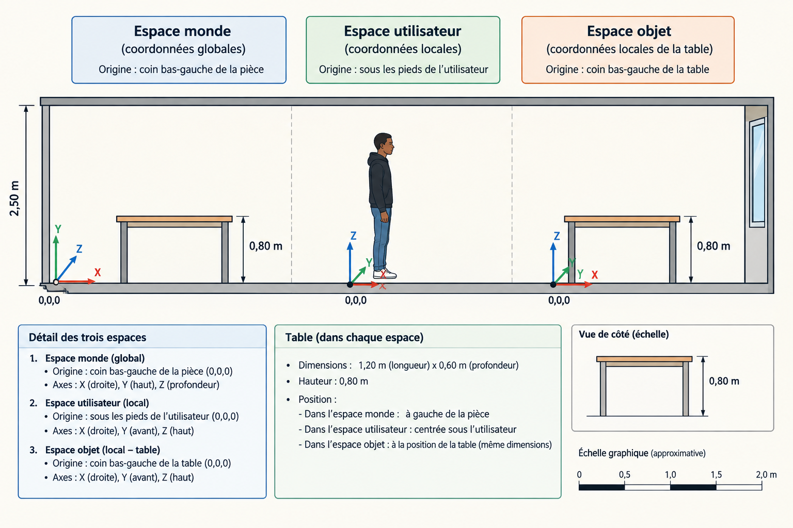

# Exercice 10 — Les trois espaces dessinés

Le dessin présente une vue de côté de la pièce avec un utilisateur debout, les origines des trois espaces et une table de hauteur **0,80 m** représentée dans chacun des trois espaces.

- **Espace monde** : origine au coin bas-gauche de la pièce.
- **Espace utilisateur** : origine sous les pieds de l'utilisateur.
- **Espace objet** : origine au coin bas-gauche de la table.
- **Table** : hauteur **0,80 m** dans les trois espaces.
